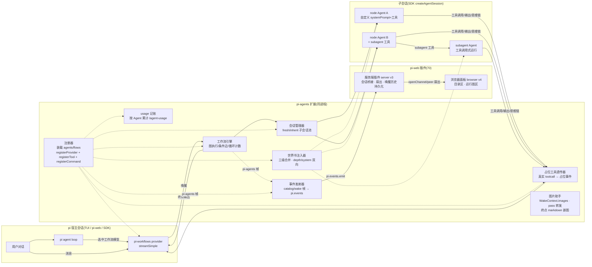

# 00 — chlamydomonos-pi-agents 架构总览

> 版本:v2(2026-10-13,新增 pi-web 插件与图片通道)
> 状态:设计文档,扩展主体已实现(pi-web 插件与图片通道为增量设计)
> 相关文档:10-Agent定义与Subagent / 20-工作流定义 / 30-虚拟模型端点 / 40-运行时与会话管理 / 50-编写指南 / 60-安装与开发 / 70-pi-web插件
> 宿主契约依据:`@earendil-works/pi-coding-agent@1.1.0` 类型定义与官方文档(extensions.md / custom-provider.md / sdk.md / message-types.md),已在设计期逐条核实;文中标注「已核实」的 API 均来自 dist/\*.d.ts。

## 1. 目标

为 Pi Coding Agent 提供一套**多智能体编排系统**:

1. **Agent 定义**:用户用 TypeScript 文件定义 Agent——系统提示词、工具白名单、世界书式对话注入、可调用的 Subagent 列表。
2. **工作流定义**:用户用 TypeScript 文件把多个 Agent 编排成有向图(**允许循环**),节点依次执行,上游最终输出默认作为下游用户消息。
3. **虚拟模型端点**:每个工作流暴露为一个可选的"模型"。用户选中后正常对话,消息直接驱动工作流;各节点 Agent 的输出/思维链映射为该虚拟模型的思维链,真实工具调用映射为**占位工具调用**(仅展示,无实际效果)。
4. **Subagent**:Agent 以工具形式调用其他 Agent,工具返回值即子 Agent 最终输出文本。

单 npm 包 `pi-agents`:pi 扩展 + pi-web 插件(70)。

## 2. 已拍板的设计决策

| #   | 决策              | 内容                                                                                                                                                                                                                                                                                                         |
| --- | ----------------- | ------------------------------------------------------------------------------------------------------------------------------------------------------------------------------------------------------------------------------------------------------------------------------------------------------------ |
| D1  | 单包形态          | `pi-agents` 一个包,同时含 pi 扩展(`pi.extensions`,jiti 免构建)与 **pi-web 插件**(`piWeb.plugins`,browser v4 + server v3,esbuild 构建出 `dist/plugin/`;见 70)。虚拟模型经 `/model` 自动出现,pi-web 中亦可选用                                                                                                 |
| D2  | 目录布局          | 父目录 `chlamydomonos-agents/`:全局 `~/.pi/agent/chlamydomonos-agents/` + 工作区 `<工作区>/.pi/chlamydomonos-agents/`,内分 `agents/` 与 `agent-flows/`(见 §4)                                                                                                                                                |
| D3  | 文件格式          | Agent/工作流均为 TypeScript 单文件(或目录形式),default 导出定义对象;**允许 import**(npm 依赖与相对模块),经 jiti 装载。信任模型同 pi 扩展(用户自担代码风险)                                                                                                                                                   |
| D4  | 循环终止          | **条件边函数为主**(TS 函数根据节点输出与运行上下文选择出边)+ **maxIterations 兜底**(防失控)                                                                                                                                                                                                                  |
| D5  | 分叉语义          | 出边多于一根时是 **if 结构**:边条件函数选中恰好一条,串行执行,**无并行**;因此不存在多入边汇合的屏障问题(多入边=多个可选上游,同一次执行只有一条被走过)                                                                                                                                                         |
| D6  | Subagent 身份     | Subagent 不是独立类别:Agent 定义可同时被 (a) 工作流节点引用 (b) 其他 Agent 的 subagent 列表引用,身份可叠加                                                                                                                                                                                                   |
| D7  | Subagent 会话     | 配置项,默认**无状态**(每次工具调用新 session);可配 `session: "inherit"` 在同一上游 session 生命周期内复用                                                                                                                                                                                                    |
| D8  | 世界书注入        | 参照 SillyTavern 世界书:注入条目按 **depth**(从对话末尾倒数第 N 条消息处)插入;**触发规则 = 用户 TS 函数**(读运行上下文,返回要注入的条目,灵活于关键词匹配);第一期不做关键词扫描器                                                                                                                             |
| D9  | 注入持久化        | **可配置**(默认不持久化):不持久化 = 每次 LLM 请求前动态重算注入(session 存储不落注入消息);持久化 = 注入消息作为 custom_message 落入 session                                                                                                                                                                  |
| D10 | 注入与系统提示词  | Agent 系统提示词走 pi 原生 `systemPrompt`(整段替换默认系统提示词);世界书条目 `target:"depth"` 注入对话记录,`target:"system"` 注入系统提示词(槽位拼接,10 §5.1)                                                                                                                                                |
| D11 | 节点会话模式      | 模式1 `fresh`:工作流每次被唤醒,该节点新建 session;模式2 `inherit`:同一宿主 session 内复用上次该节点的 session。两模式可在同一工作流中共存;**sessionMode 是工作流节点属性(NodeSpec),不在 Agent 定义中**                                                                                                       |
| D12 | 继承初始化        | inherit 模式**首次**唤醒时,以宿主当前对话(用户消息历史)为该节点初始 session;后续唤醒以自己保留的 session 继续,宿主新消息作为新 user 消息追加                                                                                                                                                                 |
| D13 | 虚拟模型实现      | **不使用** `pi.registerVirtualModel`(v1.1.0 实际不可用);用 `pi.registerProvider(name, ProviderConfig)` + 自定义 `streamSimple` 实现(见 30)                                                                                                                                                                   |
| D14 | 占位工具透传      | 工作流内各 Agent 的**每次**真实工具调用,实时映射为虚拟模型流上的占位 `toolcall` 事件 + 立即固定 toolResult(已在子会话中真实执行)                                                                                                                                                                             |
| D15 | usage/cost        | 虚拟模型 AssistantMessage 的 usage/cost **恒为 0**(避免重复计费误导);真实消耗按 Agent 维度记账,新增 `/agent-usage` 命令查看                                                                                                                                                                                  |
| D16 | 中断级联          | streamSimple 收到的 AbortSignal 级联传递到正在执行的子会话与占位工具流;宿主 Esc 中断 = 整个工作流中止                                                                                                                                                                                                        |
| D17 | 错误语义          | 节点报错 → 虚拟模型流以 error 终止(宿主 pi 有标准重试);终点节点(无出边或条件全部未选中且非循环回边)的最终 assistant 文本 = 工作流输出                                                                                                                                                                        |
| D18 | 纯函数节点        | NodeSpec 支持二选一:`agent`(子会话 LLM 节点)或 `run`(纯 TS 函数节点,无子会话无 LLM,产出 text/data;函数节点无 usage、不进思维链,仅一行 thinking 状态)                                                                                                                                                         |
| D19 | 工作流作 Subagent | SubagentSpec 的 name 可指向 Agent 或**工作流**;工作流引用 = 一次完整唤醒(task 为入口输入,终点文本为返回值);引用图(节点→Agent→subagent→工作流)装载期 DFS 查环,环上成员全部无效                                                                                                                                |
| D20 | 三级世界书        | 世界书三级来源:Agent 级(定义文件)/ 工作流级(FlowDefinition.lorebook)/ 工作区级(lorebooks/\*.ts 自动应用,ctx.agent 筛选);合并优先 Agent > 工作流 > 工作区,id 去重高层胜出;条目 target 双向:depth(对话记录)/ system(系统提示词槽位);systemPrompt 支持 string\|string[] 列表                                    |
| D21 | 图片通道          | 图片通过 WakeContext/NodeOutput 的 `images` 通道传递(用户→入口节点、节点→节点经 pass 显式转发),**仅 web 端要求最终可见**;上限:唤醒附图 ≤4 张、单图 ≤2MiB、节点产出 ≤8 张(可配);subagent/subflow 唤醒**不传图**(见 20 §8 / 40 §5.5)                                                                           |
| D22 | 嵌图最终消息      | 终点产出的图片以 **Markdown 相对路径引用**(``)追加到终点文本,**仅 pi-web 聊天渲染**(已核实 `replaceLocalMarkdownImages` 把 workspace 相对路径转 preview URL;`data:` URI 与裸 HTML `\` 被 sanitizer 剥离/转义,故不用)。TUI 不显示图(非目标);不做 appendEntry/占位工具借道方案 |
| D23 | pi-web 插件数据流 | 浏览器 panel(browser v4,workspace panel)+ 服务端插件(server v3)与扩展配对;**扩展 = 唯一真相**(装载/引擎状态都在扩展进程),服务端只做会话桥接、扇出与唤醒历史持久化;频道名 `"pi-agents"`,wire 协议单一来源 `src/shared/protocol.ts`(照 pi-comfyui 30 已验证模式;见 70)                                         |
| D24 | 运行图可视化      | 工作流面板含:目录区(Agent/工作流简易列表 + 装载警告)与运行图区(当前唤醒的节点图:当前节点高亮、环回 visit 计数、已唤醒 subagent/subflow 徽章);**条件边静态图声明 targets**(EdgeSpec.targets,纯展示字段,装载不校验);运行历史**只做实时**,不回看历史快照                                                        |

## 3. 总体架构



职责表:

| 组件           | 职责                                                                                                                                                                                       |
| -------------- | ------------------------------------------------------------------------------------------------------------------------------------------------------------------------------------------ |
| 注册器         | 扫描/装载/校验 Agent 与工作流文件(jiti,mtime 缓存);为每个工作流 `registerProvider`;注册固定工具(subagent 系列)与 `/agent-usage` 命令                                                       |
| 工作流引擎     | 拓扑执行:从入口节点起,执行节点 → 条件边选下一节点 → 循环/终点判定;维护迭代计数与运行上下文                                                                                                 |
| 会话管理器     | 按 D11/D12 管理每个节点的子会话生命周期;宿主 session 切换/结束时清理                                                                                                                       |
| 世界书注入器   | 三级来源(Agent/工作流/工作区 lorebooks)合并后以 inline extension 挂子会话:depth 条目走 `context` 事件按 depth/order 注入,system 条目进 resourceLoader 槽位;持久化/非持久化两种模式(D9/D20) |
| 占位工具透传器 | 监听子会话工具执行,把 (agent, toolName, args, result摘要) 转成虚拟模型流上的占位 toolcall 序列                                                                                             |
| usage 记账     | 从子会话 usage 事件累计;`pi.appendEntry` 持久化到宿主 session;`/agent-usage` 渲染报表                                                                                                      |
| 事件发射器     | 装载完成发 catalog 帧;引擎/透传钩子转 node/edge/spawn/wake 帧,经 `pi.events.emit("pi-agents", …)` 发给服务端插件(D23;见 70)                                                                |
| 图片助手       | WakeContext.images 提取与上限控制;pass 图片转发;终点 markdown 嵌图收尾(D21/D22;20 §8)                                                                                                      |
| pi-web 插件    | 服务端:订阅 events、扇出到浏览器 channel、唤醒历史持久化(dataDirectory);浏览器:目录区 + 运行图区面板(70)                                                                                   |

## 4. 目录布局(D2)

```
~/.pi/agent/chlamydomonos-agents/          # 全局(所有工作区可用)
├── agents/
│   ├── reviewer.ts
│   └── coder/
│       ├── index.ts                       # 目录形式:入口 index.ts
│       └── prompts.ts                     # 允许被 index.ts 相对 import
├── agent-flows/
│   ├── review-loop.ts
│   └── single-writer.ts                   # 单节点工作流 = 单 Agent 场景
└── lorebooks/
    └── house-style.ts                     # 工作区级世界书:自动对全部子会话生效(D20)

<工作区>/.pi/chlamydomonos-agents/          # 工作区(覆盖同名者;与全局并集)
├── agents/…
├── agent-flows/…
├── lorebooks/…
├── config.json                            # 两级配置(40 §11;与作者代码同目录)
├── tsconfig.json                          # /agent-init 生成:编辑期类型检查
└── pi-agents.d.ts                         # /agent-init 生成:类型 shim → types.ts
```

- `/agent-init`(50 §1.1)一键生成上述目录与两个类型提示文件(不改运行时;pi 经 jiti 直载 TS,无需构建)。

- 同名(name 冲突)时**工作区覆盖全局**;装载失败(校验不过)的文件跳过并记录 warning(见 40 §2)。
- Agent 文件**允许 import**(npm 依赖、相对模块、`@earendil-works/pi-coding-agent` 类型),jiti 直载 TS。
- 第一期不做 pi 包分发形式(用户直接把文件放进上述目录;后续可加 `pi.agents` 清单字段)。

## 5. 关键数据流

**一次对话轮(用户选中工作流模型 W 后发送消息)**

```
用户消息 → pi agent loop → 以 W 发起 provider 请求
  → W.streamSimple(model=W, context, options)
      1. 从 context.messages 提取"本次唤醒输入"(40 §4 / D12:去掉历史)
      2. 工作流引擎:入口节点 → 组装子会话输入(唤醒输入 + 世界书条目)
      3. 子会话运行:
         - assistant 文本/思维链 delta → 映射为 W 流上的 thinking/text delta(30 §3)
         - 每次工具调用 → 子会话真实执行;同时 → W 流上占位 toolcall 事件 + 固定 toolResult
         - 子 Agent 调 subagent 工具 → 递归运行子代理(同样透传)
      4. 条件边选下一节点;循环计数超限或到达终点 → 引擎结束
      5. 终点节点最终 assistant 文本 = W 的最终输出;usage/cost 置 0(D15)
  → pi agent loop 收到最终 assistant 消息(可能带占位 toolCall 块 → 执行占位工具 → 得到固定结果)
```

要点:**占位 toolCall 块出现在 W 的 assistant 消息里时,pi agent loop 会真的去执行同名工具**——所以扩展必须注册与占位调用同名的"空实现"工具(返回固定文案),并保证它们只在选中工作流模型时激活(30 §4)。子会话中真实工具的结果不回传给宿主模型(content 只给一行摘要),避免 token 浪费与上下文污染。

**Subagent 调用(Agent 定义里 subagent 列表)**

```
子会话中 Agent 调用 spawn_<name> 工具
  → 扩展内新建(或复用,按 D7)subagent 子会话
  → 同样有世界书注入与占位透传(透传目标 = 当前正在产出的 W 流)
  → 工具返回值 = subagent 最终 assistant 文本
```

## 6. 第一期范围 / 非目标

**范围内**

- Agent/工作流装载(jiti、校验、mtime 缓存、工作区覆盖全局)
- 工作流引擎:节点串行执行、条件边(含 if 分叉)、循环 + maxIterations、终点判定;纯函数节点(run)
- 两种节点会话模式(fresh/inherit)及其共存;Subagent 会话(无状态/继承),subagent 可引用工作流(subflow 一次唤醒)
- 世界书注入(用户触发函数、depth/order、持久化可配置;三级来源 + depth/system 双向 + systemPrompt 列表,D20)
- 虚拟模型端点(registerProvider + streamSimple)、占位工具透传、流映射
- `/agent-usage` 命令与按 Agent 记账
- `/agent-init` 命令:一键生成作者目录 + tsconfig + 类型 shim(50 §1.1)
- Esc 中断级联、错误 → error 流

**非目标(二期)**

- pi-web 插件(工作流执行状态图面板)
- 关键词扫描式世界书触发(ST 蓝灯)
- 多入口节点 / 并行分支 / 多入边屏障语义
- 工作流文件的热重载通知 UI(`/reload` 即可生效)
- 把 Agent 分发为 pi 包(`pi.agents` 清单)
- 跨宿主 session 的工作流运行恢复(中断后重跑)

## 7. 宿主 API 依赖清单(实现时对照)

以下均已核实存在于 pi-coding-agent@1.1.0:

| API                                                         | 用途                                                     |
| ----------------------------------------------------------- | -------------------------------------------------------- |
| `pi.registerProvider(name, ProviderConfig)`                 | 注册虚拟模型端点(每工作流一个 model 条目 + streamSimple) |
| `ProviderConfig.streamSimple`                               | 自定义 wire 协议:驱动工作流并产出事件流                  |
| `createAssistantMessageEventStream()`                       | 构造 streamSimple 返回值(`@earendil-works/pi-ai`)        |
| `createAgentSession(options)` + `SessionManager.inMemory()` | 子会话(SDK)                                              |
| `pi.registerTool` / `pi.setActiveTools`                     | subagent 工具、占位工具的注册与按模型启停                |
| `pi.on("context")`                                          | 世界书 depth 条目按深度注入(替换请求消息)                |
| `pi.on("model_select")`                                     | 感知模型切换,启停占位工具                                |
| `pi.registerCommand` / `pi.appendEntry`                     | `/agent-usage` 与记账持久化                              |
| `pi.events`                                                 | 扩展内部组件解耦(引擎↔透传器↔记账)                       |
| `session_start` / `session_shutdown`                        | 会话池生命周期、继承状态重建(见 40 §9 持久化与恢复)      |

pi-ai 侧:`AssistantMessageEvent`(start/text*\*/thinking*\_/toolcall\_\_/done/error)、`AssistantMessage.content = (TextContent|ThinkingContent|ToolCall)[]`、`Usage`(含 cost 五字段)、`getCurrentSystemPrompt`/`getCurrentTools`(从 TranscriptContext 读取请求)。

## 8. 术语表

| 术语         | 含义                                                                            |
| ------------ | ------------------------------------------------------------------------------- |
| 宿主 session | 用户所在的 pi 会话(与虚拟模型对话的那个)                                        |
| 子会话       | 扩展用 SDK 创建的 AgentSession,工作流节点或 subagent 运行其中                   |
| 唤醒(wake)   | 用户向工作流模型发送一条消息引发的一次工作流执行                                |
| 终点节点     | 无出边,或条件边函数返回"结束"的节点;其最终文本即工作流输出                      |
| 世界书条目   | depth(对话插入)或 system(提示词槽位)注入的一段提示词;三级来源自动合并(见 10 §5) |
| 占位工具调用 | 虚拟模型流上的 ToolCall 块,pi agent loop 会执行同名空实现工具,仅作展示          |
| 条件边       | 带选择函数的有向边集合;引擎调用函数得到下一个节点(或"结束")                     |
| 函数节点     | NodeSpec 用 `run` 定义的纯 TS 处理步骤(无子会话无 LLM;见 20 §2.2)               |
| subflow      | subagent 引用指向工作流时的执行形态:一次完整唤醒,终点文本为返回值(10 §6.1)      |
